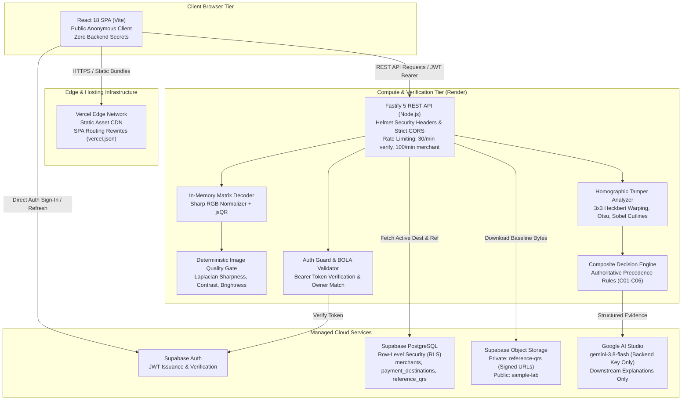
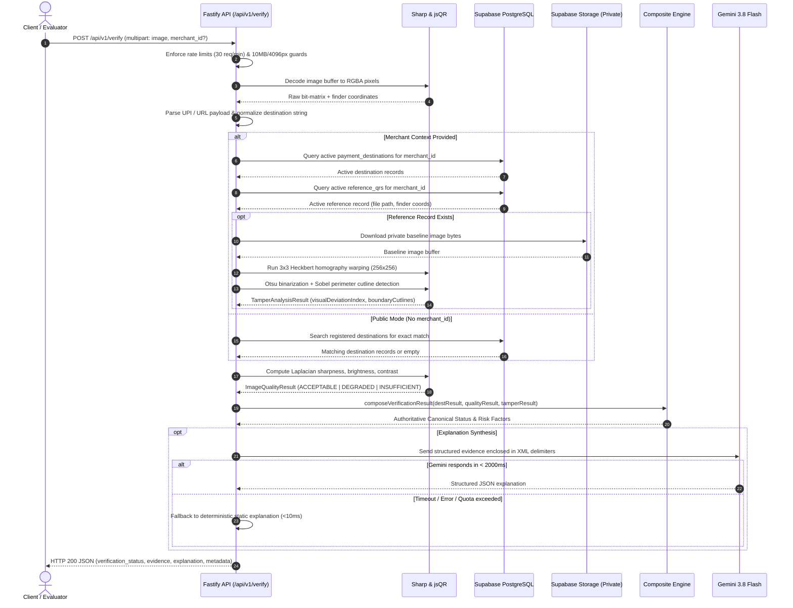
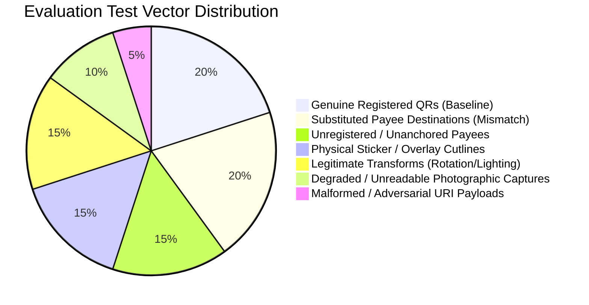

# QRShield AI

> B2B Merchant QR Integrity & Payment Destination Verification SaaS

[](#14-automated-testing--validation)
[](#14-automated-testing--validation)
[](#4-how-qrshield-works-end-to-end-pipeline)
[](#8-system-architecture--request-flow)

---

## 1. Project Title & Tagline

**QRShield AI** — B2B Merchant QR Integrity & Payment Destination Verification SaaS.

QRShield provides an evidence-based verification layer designed to protect digital payment ecosystems against QR code sticker overlay tampering, malicious destination redirection, and unanchored payee substitution.

---

## 2. Overview & Problem Statement

### The Real-World Threat: Physical & Digital QR Tampering
The explosion of QR-code-based instant payments—such as India's Unified Payments Interface (UPI), EMVCo QR standards, and generic payment links—has created a critical physical attack vector:

1. **Physical Sticker Overlays ("Quishing" & Counterfeit QR Placements)**: Fraudsters print adhesive labels bearing attacker-controlled Virtual Payment Addresses (VPAs) and paste them directly over genuine merchant QR display stands at retail counters, petrol stations, and dining tables. Customers intending to pay the merchant unknowingly transfer funds to the attacker.
2. **Payload Redirection & Typosquatting**: Malicious actors generate visually identical QR matrices that encode deceptive payment URIs, substituting similar merchant names (`store-payee@bank` instead of `store@bank`) or routing through unauthorized intermediary redirect URLs.
3. **Absence of Visual & Registry Trust Anchors**: Payment apps decode the raw payload and show only what the QR encodes. Consumers cannot verify whether a physical printed display has been altered, or whether the payment handle corresponds to the genuine merchant registered at that physical terminal.

### The QRShield Approach: Evidence-Based Verification
Rather than relying on opaque probabilistic classifiers or subjective risk guessing, QRShield anchors verification in verifiable evidence:
- **Registry Grounding**: Comparing extracted payment destinations against cryptographically authenticated merchant baselines.
- **Physical Baseline Grounding**: Comparing candidate QR photos against an authorized reference photo captured at merchant onboarding using homographic projection and edge gradient analysis.
- **Photographic Quality Gating**: Measuring exposure, contrast, and Laplacian sharpness before evaluating visual differences to eliminate false positives caused by poor lighting or camera blur.
- **Strict Separation of Concerns**: Pure deterministic CPU and database logic decides verification outcomes. Large Language Models (LLMs) are restricted strictly to downstream natural-language explanation.

---

## 3. Intended Users & Business Use Cases

| Target Persona | Operational Context | Use Case & Value Proposition |
| :--- | :--- | :--- |
| **Retail Merchants & Chains** | Physical points of sale, retail counters, restaurant tables | Registers authorized VPAs and baseline reference QR stand photos. Periodically audits physical counter displays to confirm stands have not been tampered with or replaced. |
| **Merchant Acquirers & Payment Aggregators** | Onboarding operations and field terminal audits | Verifies merchant terminal deployment photos during onboarding and automated field agent inspection workflows. |
| **Fintech Payment Apps & Wallets** | Pre-transaction scanning SDK / API integration | Programmatically submits scanned QR frames to the verification API before executing payment routing, warning users if destination substitution is detected. |
| **Field Inspectors & Loss Prevention Agents** | Countertop compliance and loss prevention | Uses the mobile-responsive web console to photograph QR stands in retail chains, verifying destination integrity across hundreds of merchant locations. |

---

## 4. How QRShield Works (End-to-End Pipeline)

From raw image input to final structured verification report, every candidate scan traverses a deterministic 12-step verification pipeline:

```
[Candidate QR Image (JPEG / PNG / WebP)]
                  │
                  ▼
   1. Multipart Ingestion & Resource Guards
      - Max file size: 10 MB
      - Max dimensions: 4096 x 4096 px (16.7M pixels)
      - MIME validation & single-file enforcement
                  │
                  ▼
   2. In-Memory Matrix Decoding
      - Sharp RGB normalization & EXIF orientation correction
      - jsQR bit-matrix analysis & finder pattern localization
                  │
                  ▼
   3. Payment URI Parsing & Parameter Extraction
      - UPI URI scheme decomposition (pa, pn, am, mc, cu)
      - Web URL extraction & plain text handling
                  │
                  ▼
   4. Canonical Destination Normalization
      - Trimming, percent-decoding, VPA canonical lowercasing
      - URL protocol and hostname standardization
                  │
                  ▼
   5. Trusted Registry Lookup
      - Supabase PostgreSQL query for active merchant registrations
      - Mode check: Public (global match) vs. Merchant Context (specific owner)
                  │
                  ▼
   6. Deterministic Destination Verification
      - Exact string comparison against active registered destination(s)
      - Destination match flag evaluation
                  │
                  ▼
   7. Photographic Image Quality Analysis
      - Mean brightness, standard deviation contrast score
      - 2D discrete Laplacian variance sharpness score
      - Dynamic range & quality gate classification (ACCEPTABLE | DEGRADED | INSUFFICIENT)
                  │
                  ▼
   8. Reference QR Retrieval (Merchant Context Mode)
      - Supabase Storage query for merchant's active baseline image
      - In-memory download from private `reference-qrs` bucket
                  │
                  ▼
   9. Homographic Visual Tamper Analysis
      - Corner detection & quadrilateral convexity validation
      - Heckbert 3x3 projective homography warping to canonical 256x256 px
      - Otsu adaptive thresholding & structural matrix divergence
      - Sobel gradient edge analysis for perimeter sticker cutlines
                  │
                  ▼
  10. Composite Verification Engine
      - Evaluates strict precedence rules (C01 through C06)
      - Produces authoritative status: VERIFIED | DESTINATION_MISMATCH |
        UNVERIFIED | SUSPICIOUS | INSUFFICIENT_EVIDENCE
                  │
                  ▼
  11. Natural-Language Explanation Layer
      - Google Gemini 3.8 Flash converts structured metrics into customer-facing text
      - Delimited prompt boundary & strict refusal of unverified claims
      - Deterministic fallback on timeout (2000ms), rate limit, or failure
                  │
                  ▼
  12. Structured JSON API Response Delivery
      - Emits UUID verification_id, dynamic ISO timestamp, duration_ms,
        evidence breakdown, risk factors, and actionable recommendation
```

---

## 5. Core Features

### 1. QR Decoding & Payment URI Parsing
- **In-Memory Decoding**: Uses `sharp` to normalize color planes and `jsqr` to extract the underlying bit matrix without temporary disk writes.
- **URI Decomposition**: Parses standard UPI protocol strings (`upi://pay?pa=...&pn=...&mc=...`), standard HTTP/HTTPS URLs, and raw text payloads.
- **Parameter Validation**: Enforces duplicate parameter rejection for security-sensitive fields (`pa`, `am`, `cu`, `pn`, `mc`), preventing parameter pollution attacks.

### 2. Canonical Destination Normalization & Comparison
- **VPA Canonicalization**: Normalizes payment addresses by trimming whitespace, decoding percent-encoded characters (`%40` $\rightarrow$ `@`, `+` $\rightarrow$ space), and lowercasing the address handle while preserving format semantics.
- **Exact Equality Enforcement**: Compares candidate destinations strictly by exact string equivalence. Fuzzy or probabilistic matching is strictly prohibited to prevent typosquatting bypasses.

### 3. Trusted Merchant Registration & Reference QR Management
- **Merchant Identity Anchoring**: Authenticated merchants create verified profiles associated with their Supabase Auth user identity.
- **Destination Whitelist**: Merchants register authorized VPAs and payment URLs, toggling active/inactive status as needed.
- **Baseline Reference Asset**: Merchants upload an authoritative reference photograph of their physical QR stand. The system extracts finder pattern coordinates, calculates a SHA-256 payload hash, stores the asset in a private storage bucket, and marks it as the active visual baseline.

### 4. Photographic Image Quality Analysis
- **Quality Gating**: Evaluates photographic viability before downstream tamper inspection:
  - **Mean Brightness**: Normalized $0.0$ to $1.0$ (flags `TOO_DARK` $< 0.20$, `TOO_BRIGHT` $> 0.85$).
  - **Contrast Score**: Standard deviation normalized by $127.5$ (flags `LOW_CONTRAST` $< 0.25$).
  - **Sharpness Score**: Discrete 2D Laplacian kernel variance normalized $0.0$ to $1.0$ (flags `BLURRY` $< 0.15$, `EXTREME_BLUR` $< 0.04$).
  - **Dynamic Range**: Normalized spread of pixel intensity.
- **Fail-Safe Gate**: Severely degraded images yield `INSUFFICIENT_EVIDENCE` immediately, preventing false-positive tamper alerts caused by camera blur or low light.

### 5. Reference-Based Visual Tamper Analysis
- **Homographic Perspective Warping**: Computes a closed-form 3x3 projective homography matrix (Heckbert algorithm) mapping candidate QR finder pattern corners to a canonical $256 \times 256$ pixel matrix.
- **Otsu Binarization**: Automatically selects optimal binarization thresholds to resist uneven ambient lighting.
- **Perimeter Cutline Detection**: Applies Sobel gradient magnitude filtering across the quiet zone and outer perimeter to detect sharp edge step discontinuities characteristic of adhesive sticker overlays.
- **Structural Divergence**: Measures binary matrix mismatch ratio and normalized structural grayscale differences.

### 6. Composite Verification Engine & Reason Codes
- **Rule-Based Decision Logic**: Combines destination parity, image quality metrics, and visual comparison indices into a single authoritative status via strict precedence rules.
- **Machine-Readable Reason Codes**: Emits explainable factors including `DESTINATION_MATCH`, `DESTINATION_CONFLICT`, `NO_TRUSTED_REGISTRATION`, `BOUNDARY_EDGE_ANOMALY`, `IMAGE_QUALITY_INSUFFICIENT`, and `TAMPER_ANALYSIS_INCONCLUSIVE`.

### 7. Gemini-Assisted Explanations with Deterministic Fallback
- **Downstream Explanation Only**: Google Gemini (`gemini-3.8-flash`) synthesizes technical metrics into neutral, customer-accessible summaries.
- **Strict Decoupling Invariant**: Gemini has **zero** authority over the canonical verification status. It cannot modify, elevate, or downgrade verdicts.
- **Security Delimiters**: Evidence passed to the model is enclosed in `<verification_evidence>` tags with escaped closing brackets to prevent prompt injection.
- **Deterministic Fallback**: If Gemini times out (configurable, default 2000ms), encounters quota limits, or returns invalid schema data, the system instantly serves pre-compiled, deterministic rule-based text in $< 10\text{ms}$.

### 8. Merchant Authentication & Ownership Checks
- **Supabase Auth Integration**: Full sign-up, sign-in, session refresh, and route guarding.
- **Strict Session Derivation**: Profile and destination creations derive `user_id` strictly from verified server-side session tokens, preventing unauthenticated row creation.
- **Broken Object Level Authorization (BOLA/IDOR) Defense**: All merchant subresource routes (`/api/v1/merchants/:merchantId/*`) verify caller bearer tokens and enforce `merchant.user_id === authenticatedUser.id` prior to performing any database or storage operations.

### 9. API Rate Limiting
- **IP & Token Throttling**: Powered by `@fastify/rate-limit`. Public verification routes enforce 30 requests/minute per client IP. Authenticated merchant routes enforce 100 requests/minute keyed by merchant ID and token hash.
- **Reverse Proxy Support**: Implements strict `CF-Connecting-IP` validation when operating in the Render cloud environment (`RENDER=true`), falling back securely to socket IP elsewhere to prevent header spoofing.

### 10. Audit Logging Capabilities & Limitations
- **Structured JSON Logging**: Every verification request logs a unique UUID `verification_id`, dynamic ISO 8601 timestamp, execution duration in milliseconds, canonical verdict, and explanation provider to standard output.
- **Sensitive Data Redaction**: Fastify logger automatically redacts passwords, session tokens, API keys, raw image buffers, and authorization headers.
- **Current Limitation**: Persistence to the database `verification_logs` table (Phase 10) is currently pending; verification telemetry is logged to server runtime stdout/stderr and not yet exposed in a merchant dashboard query view.

---

## 6. Canonical Verification Outcomes

QRShield evaluates scans into five mutually exclusive canonical statuses. It strictly avoids sensationalist or legally loaded language such as "scam guaranteed" or "fake QR".

| Canonical Status | Evaluation Criteria | Meaning & Trust Implication | Actionable Recommendation |
| :--- | :--- | :--- | :--- |
| **`VERIFIED`** | Scanned destination matches an active trusted merchant destination, image quality is acceptable, and no visual tampering or border cutlines are detected. | **Destination matched available registry/reference.** The scanned payment destination corresponds to the merchant's verified baseline. | `REVIEW_NOT_REQUIRED` |
| **`DESTINATION_MISMATCH`** | Scanned destination directly conflicts with the active trusted destination registered for the specified merchant context. | **Unauthorized payee redirection detected.** The QR redirects funds away from the merchant's registered account. | `DO_NOT_PROCEED_WITH_PAYMENT` |
| **`UNVERIFIED`** | Payment destination is syntactically well-formed, but has no active matching record in the registry (or scan was submitted in public mode without merchant context). | **Unanchored destination.** Destination is well-formed but unconfirmed in registry. Does not inherently indicate fraud. | `VERIFY_MERCHANT_BEFORE_PAYMENT` |
| **`SUSPICIOUS`** | Destination matches registered destination, but visual comparison against the reference baseline reveals physical anomalies (e.g. perimeter cutlines, matrix structure divergence). | **Potential physical overlay detected.** Scanned code shows physical sticker characteristics. Manual physical inspection recommended. | `MANUAL_INSPECTION_RECOMMENDED` |
| **`INSUFFICIENT_EVIDENCE`** | Image quality is degraded (extreme blur, underexposure, glare, low resolution, or missing finder patterns), preventing reliable decoding or analysis. | **Quality gate tripped.** Photographic capture is insufficient to form an evidence-based conclusion. | `CAPTURE_CLEARER_IMAGE` |

> [!IMPORTANT]
> **What `VERIFIED` Actually Means**:
> A status of `VERIFIED` certifies solely that the scanned payment destination matches an active, authorized destination registered by the merchant, and that no physical tamper anomalies exceeded detection thresholds against the baseline reference image.
>
> **It does NOT prove**:
> 1. Legal or beneficial ownership of the underlying commercial bank account.
> 2. Actual settlement, clearance, or successful processing of a financial transaction.
> 3. Universal absence of fraud, social engineering, or off-platform disputes.

---

## 7. Technology Stack

Exact dependencies and versions sourced directly from [`frontend/package.json`](file:///d:/My%20Photos%20&%20Videos/Jahnavi/QR%20Shield/QR-Shield/frontend/package.json) and [`backend/package.json`](file:///d:/My%20Photos%20&%20Videos/Jahnavi/QR%20Shield/QR-Shield/backend/package.json):

```
QRShield Technology Stack
├── Frontend Application
│   ├── React (v18.3.1) & React DOM (v18.3.1)
│   ├── React Router DOM (v6.28.0)
│   ├── Lucide React (v1.51.0)
│   ├── Vite (v6.0.1) & @vitejs/plugin-react (v4.3.4)
│   └── Vanilla CSS (Obsidian/Slate design tokens: tokens.css + index.css)
├── Backend REST API Service
│   ├── Node.js (v20+ / v24 compatible)
│   ├── Fastify (v5.2.1) & fastify-plugin (v5.0.1)
│   ├── @fastify/cors (v10.0.2)
│   ├── @fastify/helmet (v13.0.1)
│   ├── @fastify/multipart (v10.1.2)
│   └── @fastify/rate-limit (v11.2.1)
├── QR Decoding & Image Processing
│   ├── Sharp (v0.35.5) — Color plane normalization, EXIF rotation, resizing, Laplacian filtering
│   ├── jsQR (v1.4.0) — Pure TypeScript bit-matrix decoding & finder pattern localization
│   └── Custom Homography & Gradient Engine — Heckbert 3x3 projective warping, Otsu, Sobel
├── Database, Authentication & Storage
│   ├── Supabase Cloud PostgreSQL — Relational data storage with Row-Level Security
│   ├── @supabase/supabase-js (v2.117.2) — Client & backend service SDK
│   ├── Supabase Auth — JWT token issuance, session lifecycle, and bcrypt hashing
│   └── Supabase Storage — Private `reference-qrs` bucket and public `sample-lab` bucket
├── AI Explanation Integration
│   ├── @google/genai (v2.27.0) — Official Google Gen AI SDK
│   └── Model: gemini-3.8-flash — Structured JSON explanation synthesis with schema validation
└── Testing & Developer Tooling
    ├── TypeScript (v5.6.3) — Strict mode with dedicated tsconfig.build.json
    ├── Vitest (v5.0.3) — Unit, integration, and security test runner
    ├── JSDOM (v30.1.2) & @testing-library/react (v16.3.3) — Frontend DOM testing
    ├── ESLint (v9.16.0) & typescript-eslint (v8.17.0) — Static code analysis
    ├── Prettier (v3.4.2) — Code formatting
    ├── TSX (v4.19.2) — TypeScript execution runner for development & benchmarks
    └── QRCode (v1.5.4) — Synthetic test vector generation (dev dependency only)
```

---

## 8. System Architecture & Request Flow

### 8.1 Multi-Tier Architecture & Security Boundaries



### 8.2 End-to-End Verification Request Sequence



---

## 9. API Reference & Documentation

### 1. Health Check
- **Endpoint**: `GET /api/v1/health`
- **Authentication**: None (Public)
- **Rate Limit**: Default global (100 req/min)
- **Response Example**:
```json
{
  "status": "ok",
  "version": "1.0.0",
  "timestamp": "2026-10-27T08:30:00.000Z",
  "uptime": 1420.55
}
```

---

### 2. QR Destination Verification
- **Endpoint**: `POST /api/v1/verify`
- **Authentication**: Optional (supports anonymous public verification or merchant-context verification)
- **Content-Type**: `multipart/form-data`
- **Fields**:
  - `image` (required, File): PNG, JPEG, or WebP (max 10 MB, max $4096 \times 4096$ px).
  - `merchant_id` (optional, string): Canonical UUID v4 of the target merchant profile.
  - `opt_in_audit` (optional, boolean): Logging opt-in flag.
- **Rate Limit**: 30 requests/minute per client IP.
- **Response Example (`200 OK`)**:
```json
{
  "verification_status": "VERIFIED",
  "decoded_payload": "upi://pay?pa=store@icici&pn=Sample%20Store&mc=5411",
  "normalized_destination": "store@icici",
  "registered_destination": "store@icici",
  "destination_match": true,
  "evidence": {
    "normalized_scanned_destination": "store@icici",
    "active_trusted_destinations_checked": 1,
    "exact_match": true
  },
  "image_quality": {
    "overall_quality": "ACCEPTABLE",
    "mean_brightness": 0.52,
    "contrast_score": 0.48,
    "sharpness_score": 0.72,
    "dynamic_range": 0.94,
    "brightness_classification": "ACCEPTABLE",
    "contrast_classification": "ACCEPTABLE_CONTRAST",
    "sharpness_classification": "ACCEPTABLE_SHARPNESS",
    "quality_flags": []
  },
  "composite_evidence": {
    "destination": {
      "scanned_destination": "store@icici",
      "destination_match": true,
      "active_trusted_destinations_checked": 1,
      "exact_match": true
    },
    "image_quality": {
      "overall_quality": "ACCEPTABLE",
      "brightness_classification": "ACCEPTABLE",
      "contrast_classification": "ACCEPTABLE_CONTRAST",
      "sharpness_classification": "ACCEPTABLE_SHARPNESS"
    },
    "tamper": {
      "available": true,
      "reference_available": true,
      "visual_deviation_index": 0.002,
      "alignment_quality": 0.96,
      "alignment_classification": "GOOD",
      "matrix_mismatch_ratio": 0.001,
      "boundary_anomaly_detected": false,
      "boundary_anomaly_score": 0.04,
      "anomaly_indicators": [],
      "recommendation": "NO_SIGNIFICANT_VISUAL_DEVIATION"
    }
  },
  "risk_factors": [],
  "recommendation": "REVIEW_NOT_REQUIRED",
  "explanation": "The scanned payment destination matches the merchant's registered account (store@icici), and photographic inspection confirms consistent matrix structure and baseline alignment.",
  "explanation_metadata": {
    "provider": "gemini",
    "model": "gemini-3.8-flash"
  },
  "processing_metadata": {
    "verification_id": "f81d4fae-7dec-11d0-a765-00a0c91e6bf6",
    "timestamp": "2026-10-27T08:30:00.120Z",
    "duration_ms": 112.4
  }
}
```

---

### 3. Merchant Destination Management
All destination endpoints require bearer authentication: `Authorization: Bearer <jwt>` and enforce `merchant.user_id === authenticatedUser.id`. Rate limited to 100 req/min.

#### List Destinations
- **Endpoint**: `GET /api/v1/merchants/:merchantId/destinations`
- **Response (`200 OK`)**:
```json
{
  "destinations": [
    {
      "id": "7b8e1920-5621-4f90-8d51-382901234567",
      "merchant_id": "51bc512c-7945-4404-bd24-4316ce924daa",
      "destination_type": "VPA",
      "destination_value": "store@icici",
      "is_active": true,
      "created_at": "2026-10-01T10:00:00.000Z"
    }
  ]
}
```

#### Create Destination
- **Endpoint**: `POST /api/v1/merchants/:merchantId/destinations`
- **Request Body**:
```json
{
  "destination_type": "VPA",
  "destination_value": "newstore@hdfcbank",
  "is_active": true
}
```
- **Response (`201 Created`)**:
```json
{
  "destination": {
    "id": "8c9f2031-6732-5a01-9e62-493012345678",
    "merchant_id": "51bc512c-7945-4404-bd24-4316ce924daa",
    "destination_type": "VPA",
    "destination_value": "newstore@hdfcbank",
    "is_active": true,
    "created_at": "2026-10-27T08:35:00.000Z"
  }
}
```

#### Update Destination
- **Endpoint**: `PUT /api/v1/merchants/:merchantId/destinations/:destinationId`
- **Request Body**:
```json
{
  "is_active": false
}
```
- **Response (`200 OK`)**:
```json
{
  "destination": {
    "id": "8c9f2031-6732-5a01-9e62-493012345678",
    "merchant_id": "51bc512c-7945-4404-bd24-4316ce924daa",
    "destination_type": "VPA",
    "destination_value": "newstore@hdfcbank",
    "is_active": false,
    "updated_at": "2026-10-27T08:36:00.000Z"
  }
}
```

#### Delete Destination
- **Endpoint**: `DELETE /api/v1/merchants/:merchantId/destinations/:destinationId`
- **Response (`200 OK`)**:
```json
{
  "success": true,
  "message": "Payment destination removed successfully."
}
```

---

### 4. Merchant Reference QR Management
Requires bearer authentication: `Authorization: Bearer <jwt>` and owner authorization. Rate limited to 100 req/min.

#### Get Active Reference QR
- **Endpoint**: `GET /api/v1/merchants/:merchantId/reference-qr`
- **Response (`200 OK`)**:
```json
{
  "reference_qr": {
    "id": "3fa85f64-5717-4562-b3fc-2c963f66afa6",
    "merchant_id": "51bc512c-7945-4404-bd24-4316ce924daa",
    "file_path": "51bc512c-7945-4404-bd24-4316ce924daa/reference-qr-1729000000.png",
    "payload_hash": "e3b0c44298fc1c149afbf4c8996fb92427ae41e4649b934ca495991b7852b855",
    "signed_url": "https://your-project.supabase.co/storage/v1/object/sign/reference-qrs/...?token=...",
    "created_at": "2026-10-15T09:00:00.000Z"
  }
}
```

#### Upload Reference QR
- **Endpoint**: `POST /api/v1/merchants/:merchantId/reference-qr`
- **Content-Type**: `multipart/form-data` with `image` (max 10MB)
- **Response (`201 Created`)**: Returns active record with fresh 300-second signed preview URL.

#### Delete Reference QR
- **Endpoint**: `DELETE /api/v1/merchants/:merchantId/reference-qr`
- **Response (`200 OK`)**:
```json
{
  "success": true,
  "message": "Reference QR removed successfully."
}
```

---

### 5. Evaluator Sample Lab Catalog
- `GET /api/v1/samples`: Returns array of 5 reproducible test specimens with expected statuses and payloads.
- `GET /api/v1/samples/:sampleId`: Returns single specimen metadata.
- `GET /api/v1/samples/:sampleId/image`: Streams the physical test PNG asset directly.

---

## 10. Local Development Setup (Windows & PowerShell)

### Prerequisites
- **Node.js**: `v20.x` or `v24.x` (LTS recommended)
- **Package Manager**: `npm v10.x` or higher
- **PowerShell**: Windows PowerShell 5.1 or PowerShell Core 7+
- **Git**: Installed and accessible on `PATH`

### 1. Clone the Repository
```powershell
git clone https://github.com/ReddyJahnaviDevarinti/QR-Shield.git
cd QR-Shield
```

### 2. Configure Environment Variables
Copy template files to local environment files (these are tracked in `.gitignore`):

```powershell
# Copy backend template
Copy-Item backend\.env.example backend\.env

# Copy frontend template
Copy-Item .env.example frontend\.env.local
```

### 3. Install Dependencies
Install packages in both directories:

```powershell
# Install backend dependencies
cd backend
npm install

# Install frontend dependencies
cd ..\frontend
npm install
cd ..
```

### 4. Running the Development Servers

Open two separate PowerShell terminal windows:

**Terminal 1 — Backend REST API**:
```powershell
cd backend
npm run dev
# Server will listen at http://localhost:8000
# Verified health endpoint: http://localhost:8000/api/v1/health
```

**Terminal 2 — Frontend Application**:
```powershell
cd frontend
npm run dev
# Vite dev server will launch at http://localhost:5173
```

### 5. Executing Tests & Quality Checks

**Frontend Suite**:
```powershell
cd frontend
npm test                # Executes Vitest suite (65 tests)
npm run lint            # Executes ESLint checks
npm run format:check    # Verifies Prettier compliance
npm run build           # Compiles production distribution bundle
```

**Backend Suite**:
```powershell
cd backend
npm test                # Executes Vitest suite (314+ unit/mock tests)
npm run lint            # Executes ESLint checks
npm run format:check    # Verifies Prettier compliance
npm run build           # Compiles production TypeScript via tsconfig.build.json
npm run benchmark       # Runs deterministic pipeline latency telemetry
npm run sample:validate # Validates synthetic test vectors against pipeline
```

---

## 11. Environment Configuration Reference

Safe variable names and non-secret placeholder examples:

### Backend Configuration (`backend/.env`)

| Variable Name | Required | Default / Example Value | Purpose |
| :--- | :--- | :--- | :--- |
| `PORT` | Optional | `8000` | Port for the Fastify server. Render assigns this dynamically. |
| `HOST` | Optional | `0.0.0.0` | Bind host address. Must be `0.0.0.0` for containerized environments. |
| `NODE_ENV` | Optional | `development` | Runtime environment (`development`, `production`, `test`). |
| `ALLOWED_ORIGINS` | Required in prod | `http://localhost:5173,https://qr-shield-seven.vercel.app` | Comma-separated list of permitted CORS origins. |
| `SUPABASE_URL` | **Required** | `https://your-project-id.supabase.co` | Supabase Cloud API endpoint URL. |
| `SUPABASE_SECRET_KEY` | **Required** | `sb_secret_REPLACE_ME` | Supabase Service Role Key (bypasses RLS for registry & storage). **Never expose to client.** |
| `GEMINI_API_KEY` | Optional | `AIzaSy_REPLACE_ME` | Google AI Studio API key. If absent, system automatically uses deterministic fallbacks. |
| `GEMINI_TIMEOUT_MS` | Optional | `2000` | Timeout window before falling back to deterministic explanation text. |
| `RATE_LIMIT_ENABLED` | Optional | `true` | Enables or disables API rate limiting. |
| `RATE_LIMIT_VERIFY_MAX` | Optional | `30` | Maximum verification requests per minute per IP. |
| `RATE_LIMIT_MERCHANT_MAX`| Optional | `100` | Maximum merchant management requests per minute per merchant. |
| `RATE_LIMIT_WINDOW_MS` | Optional | `60000` | Rate limiting sliding time window in milliseconds (default 1 min). |
| `RENDER` | Optional | `false` | Set to `true` on Render to enable trusted Cloudflare IP resolution. |

### Frontend Configuration (`frontend/.env.local`)

| Variable Name | Required | Default / Example Value | Purpose |
| :--- | :--- | :--- | :--- |
| `VITE_API_BASE_URL` | Optional | `http://localhost:8000` | Backend API base URL. Set to Render production URL for production builds. |
| `VITE_SUPABASE_URL` | **Required** | `https://your-project-id.supabase.co` | Public Supabase project URL. |
| `VITE_SUPABASE_PUBLISHABLE_KEY` | **Required** | `sb_publishable_REPLACE_ME` | Public, client-safe anonymous Supabase key. |
| `VITE_APP_ENV` | Optional | `development` | Client runtime mode (`development`, `staging`, `production`). |

> [!CAUTION]
> **Secret Boundary Invariant**:
> `SUPABASE_SECRET_KEY` and `GEMINI_API_KEY` must **never** be supplied to the frontend or prefixed with `VITE_`. Automated CI test [`frontend/src/security.test.ts`](file:///d:/My%20Photos%20&%20Videos/Jahnavi/QR%20Shield/QR-Shield/frontend/src/security.test.ts) scans built bundles to ensure zero secret tokens exist in static client code.

---

## 12. Deployment Architecture

| Tier / Component | Provider / Platform | Production URL | Configuration Notes |
| :--- | :--- | :--- | :--- |
| **Web Console (SPA)** | Vercel (Edge CDN) | [qr-shield-seven.vercel.app](https://qr-shield-seven.vercel.app/) | Root rewrite rules configured via [`frontend/vercel.json`](file:///d:/My%20Photos%20&%20Videos/Jahnavi/QR%20Shield/QR-Shield/frontend/vercel.json) to handle React Router client-side routes (`/verify`, `/dashboard`, `/sample-lab`, `/login`). |
| **Backend REST API** | Render Web Service | [qrshield-backend-elj6.onrender.com](https://qrshield-backend-elj6.onrender.com) | Node.js web service running `node dist/server.js`. Bound to `0.0.0.0:$PORT`. Health check at `/api/v1/health`. |
| **Database & Auth** | Supabase Cloud | Managed PostgreSQL instance | Handles user identity via Supabase Auth and data persistence across tables. |
| **Object Storage** | Supabase Storage | Multi-bucket object store | Private bucket `reference-qrs` for merchant baseline images; public bucket `sample-lab` for evaluator test specimens. |

---

## 13. Security Hardening & Implementation Status

Security controls implemented across Checkpoints 1, 1.1, and 1.2:

### Checkpoint 1: Production Rate Limiting & Resource Exhaustion Defense
- **Fastify Rate Limiting**: Implemented via `@fastify/rate-limit` with custom `keyGenerator` logic.
- **Decompression Bomb Protection**: Input images are inspected via Sharp metadata pre-flight before decompression. Files exceeding `MAX_IMAGE_DIMENSION = 4096` pixels or `MAX_IMAGE_PIXELS = 16_777_216` pixels are rejected immediately with HTTP 400.
- **Multipart Guarding**: Maximum payload size enforced at 10 MB. Extra uploaded files and non-image streams are rejected and safely drained.

### Checkpoint 1.1: BOLA/IDOR Hardening & Destination API Isolation
- **Broken Object Level Authorization Defense**: Endpoints under `/api/v1/merchants/:merchantId/*` authenticate caller bearer tokens and compare `merchant.user_id === authenticatedUser.id`. Foreign tenant mutations terminate with HTTP 403 `E_FORBIDDEN` without leaking database schema details.
- **Backend Destination Migration**: All destination management (`GET`, `POST`, `PUT`, `DELETE`) is mediated through backend API routes (`/api/v1/merchants/:merchantId/destinations`) rather than direct client database mutations.
- **Proxy IP Resolution**: `resolveClientIp` validates `CF-Connecting-IP` against `net.isIP()` exclusively when `RENDER=true`. `X-Forwarded-For` is intentionally unparsed to prevent client header spoofing.

### Checkpoint 1.2: Storage Isolation & Database RLS Migrations
- **Private Storage Bucket**: Reference QR images are stored in a non-public bucket (`reference-qrs`). Signed preview URLs with an ephemeral 300-second TTL are generated strictly for authenticated owners.
- **Committed vs. Applied RLS Policies**:
  - `migrations/001_merchants_rls.sql`: **APPLIED & VERIFIED** on production Supabase. Enforces `auth.uid() = user_id` across `merchants` table mutations.
  - `migrations/002_destinations_and_storage_rls.sql`: **COMMITTED MIGRATION ARTIFACT**. Contains authoritative SQL policies for `payment_destinations`, `reference_qrs`, `verification_logs`, and `storage.objects`. It is committed to version control for administrative review and staging verification; it is **NOT** claimed to be automatically applied to the live production database.

---

## 14. Automated Testing & Validation

### Test Suites Overview

| Suite | Runner / Framework | Tests Executed | Status | Coverage Focus |
| :--- | :--- | :--- | :--- | :--- |
| **Frontend Suite** | Vitest + RTL + JSDOM | **65 passed** | All Passing | Router navigation, AuthContext session derivation, VerifyPage, DashboardPage, SampleLab, token hygiene, zero-secret bundle scan. |
| **Backend Suite** | Vitest | **314+ passed** (offline/mock) | Passing | QR matrix decoding, UPI parsing, image quality analyzer, homographic tamper engine, composite rules, rate limiting, BOLA auth guard, reference QR routes. |
| **Build Integrity** | TypeScript Compiler | `tsc -b` & `tsc -p tsconfig.build.json` | 0 Errors | Strict mode type verification across both applications. Isolated build config prevents test files from compiling into production backend bundle. |
| **Code Quality** | ESLint + Prettier | `npm run lint` & `format:check` | 0 Errors / Warnings | Static linting and code style conformance. |
| **Sample Validation** | Custom TSX script | 5 / 5 specimens validated | Passing (with registry) | Reproducible verification of all 5 canonical statuses against the verification engine. |

### Running the Test Suites

```powershell
# Run frontend test suite
cd frontend
npm test

# Run backend test suite
cd ..\backend
npm test

# Run production build checks
npm run build
```

> [!NOTE]
> **Regression Pass Rate vs. Fraud Detection Accuracy**:
> A 100% pass rate in the automated regression test suites means that the codebase faithfully conforms to its unit test specifications, type contracts, boundary error guards, and deterministic rule algorithms.
>
> **Regression pass rate is not fraud detection accuracy.** Real-world fraud detection accuracy depends on physical lighting variability, camera sensor resolutions, sticker print qualities, and evolving adversarial physical concealment techniques, which require continuous evaluation against empirical benchmarks.

---

## 15. Development Phases & Implementation Status

| Phase | Milestone Name | Scope & Deliverables | Status |
| :--- | :--- | :--- | :--- |
| **Phase 0** | Project Foundation | Architecture, engineering rules, design tokens, repository scaffolding. | **COMPLETED** |
| **Phase 1** | Authentication | Supabase Auth, sign-in/up UI, session provider, protected route guard. | **COMPLETED** |
| **Phase 2** | Dashboard Shell | Accessible UI library, responsive navigation, slate design system. | **COMPLETED** |
| **Phase 3** | Merchant Registration | Profile onboarding, backend destination API routes, reference QR upload. | **COMPLETED** |
| **Phase 4** | QR Ingestion & Decoding | In-memory Sharp normalization, jsQR matrix decoder, dimension guards. | **COMPLETED** |
| **Phase 5** | Destination Parity Engine | UPI URI parameter decomposition, canonical VPA normalization, exact string equality matching. | **COMPLETED** |
| **Phase 6** | Physical Tamper Analyzer | Heckbert 3x3 projective homography, Otsu thresholding, Sobel quiet-zone cutline detection. | **COMPLETED** |
| **Phase 7** | Composite Decision Engine | Precedence evaluation rules (C01–C06), risk factor aggregation, recommendation mapping. | **COMPLETED** |
| **Phase 8** | Gemini Explanation Layer | gemini-3.8-flash integration, prompt injection delimiters, deterministic fallback. | **COMPLETED** |
| **Phase 9** | Evaluator Sample Lab | Synthetic specimen catalog, image streaming endpoints, live browser execution UI. | **COMPLETED** |
| **Phase 10** | Persistent Audit Logs | Database writing to `verification_logs` table and merchant history dashboard view. | **PLANNED** |
| **Phase 11** | Production Hardening | Rate limiting, BOLA/IDOR auth guards, proxy IP validation, bundle secret audits. | **COMPLETED** |
| **Phase 12** | Cloud Deployment | Vercel Edge frontend deploy, Render backend service deploy, Supabase cloud configuration. | **COMPLETED (Monitoring)** |
| **Phase 13** | Enterprise Multi-Tenancy | Distributed rate limiting (Redis), multi-region active replication, advanced compliance audits. | **PLANNED** |

---

## 16. Benchmark & Evaluation Strategy

QRShield utilizes an evaluation methodology based on seven test classes designed to rigorously stress-test each layer of the verification pipeline:



1. **Genuine Registered QRs (Baseline)**: Valid payment addresses matching active merchant registrations and reference baseline photos. Must consistently yield `VERIFIED`.
2. **Substituted Payee Destinations (Destination Mismatch)**: QR codes bearing the merchant's display branding but redirecting to an unauthorized third-party payment handle. Must yield `DESTINATION_MISMATCH`.
3. **Unregistered / Unanchored Destinations**: Decodable payment codes scanned in public mode without an anchored merchant registration. Must yield `UNVERIFIED` without falsely alleging fraud.
4. **Physical Sticker / Overlay Cutlines**: Candidate codes matching registered destinations but exhibiting border step discontinuities, quiet-zone cutlines, or matrix structure divergence. Must yield `SUSPICIOUS`.
5. **Legitimate Photographic Transforms**: Benign real-world capture variations, including moderate perspective tilts ($\le 30^\circ$), natural ambient illumination shifts, and slight scaling differences. The homographic engine must normalize these without false-positive tamper flags.
6. **Degraded / Unreadable Photographic Captures**: Images with severe motion blur, extreme underexposure ($< 0.18$ brightness), severe glare, or occluded finder patterns. Must trip the image quality gate and yield `INSUFFICIENT_EVIDENCE`.
7. **Malformed & Adversarial Payloads**: Parameter pollution attacks (e.g. duplicate `pa` parameters), invalid currency codes, oversized payloads, and non-URI strings. Must be rejected cleanly by the parser without unhandled exceptions.

*Notice: Results from the Evaluator Sample Lab represent synthetic test vectors created to demonstrate deterministic pipeline mechanics; empirical multi-camera statistical benchmarks remain part of the ongoing roadmap.*

---

## 17. Honest System Limitations

Fintech security requires full transparency regarding operational assumptions and technical boundaries:

1. **Heuristic Nature of Visual Tamper Detection**: The physical tamper engine relies on computer-vision heuristics (Sobel edge discontinuities, Otsu binarization, and structural matrix mismatch). Highly sophisticated physical attacks—such as professional factory re-printing of an entire acrylic display stand—will not produce sticker edge cutlines and must be caught via destination parity verification.
2. **Reference Image Prerequisite**: Visual comparison is possible **only** when the merchant has registered an authoritative baseline Reference QR photograph. When no reference is registered, the system performs destination verification with `tamper.available = false`.
3. **Severe Perspective & Lighting Limits**: Captures photographed at acute angles ($> 45^\circ$) or with harsh specular glare obscuring finder patterns will fail the image quality gate, returning `INSUFFICIENT_EVIDENCE`.
4. **Destination Verification is Not Payment Confirmation**: Confirming that a QR encodes `merchant@bank` confirms that the scanned display points to the merchant's registered handle. It does **not** verify that the payer has sufficient funds, that the banking network is operational, or that payment settlement has completed.
5. **Public Mode vs. Merchant Context Guarantees**: Public mode verification operates without merchant identity context and can only confirm whether a destination exists in the registry. It cannot detect payee substitution if the attacker's destination is also registered elsewhere in the system.
6. **In-Memory Rate Limiting Scope**: Rate limiting is currently managed in-memory on each Fastify process instance. Multi-instance horizontal scaling on Render or Kubernetes requires a shared distributed cache (e.g., Redis) to enforce global rate limits across all nodes.

---

## 18. Future Roadmap

- [ ] **Empirical Benchmark Suite**: Publication of a standardized, labelled evaluation dataset containing 1,000+ physical photographs of genuine, tampered, and weather-degraded QR codes across varied smartphone cameras.
- [ ] **False-Positive Reduction in Complex Lighting**: Integration of localized contrast equalization (CLAHE) to improve homographic alignment under direct sunlight and shadow casting.
- [ ] **Persistent Audit History (Phase 10)**: Implementation of automated asynchronous worker writes to the `verification_logs` database table and an interactive audit history explorer in the Merchant Dashboard.
- [ ] **Shared Distributed Rate Limiting**: Redis-backed rate limiting plugin for multi-instance production backend deployments.
- [ ] **Multi-Tenant Security Audit**: Formal third-party penetration testing and automated dynamic application security testing (DAST) on live API endpoints.
- [ ] **Mobile SDK & Camera Preview Integration**: Lightweight React Native and Flutter client SDKs for real-time video frame stream pre-filtering before API submission.
- [ ] **Authorized Acquirer Pilot**: Pilot deployment with payment aggregators to evaluate field inspection workflows across retail merchant networks.

---

## 19. Responsible-Use & Security Disclaimer

> [!CAUTION]
> **Operational Trust Notice**:
> QRShield AI is a verification-assistance platform engineered to assist merchants, consumers, and payment providers in verifying payment QR codes against registered baselines.
>
> - QRShield **does not** connect directly to banking core switches or private financial ledgers.
> - QRShield **does not** independently certify the legal identity of bank account holders behind payment handles.
> - QRShield **does not** guarantee that a payment destination is universally free of financial or operational risk.
> - QRShield **does not** process, authorize, hold, or settle monetary transactions.
>
> QRShield is not certified under SOC 2, PCI-DSS, or ISO 27001, and should not be represented as a certified financial firewall. Users and automated systems must exercise standard financial caution before completing monetary transfers.

---

## 20. Project Metadata & Contributing

### Maintainer & Repository
- **Project**: QRShield AI
- **Repository**: [https://github.com/ReddyJahnaviDevarinti/QR-Shield](https://github.com/ReddyJahnaviDevarinti/QR-Shield)
- **Primary Branch**: `main`

### Contributing
Contributions that enhance verification determinism, expand automated test coverage, or improve computer vision heuristics are welcome:
1. Fork the repository and create a feature branch (`git checkout -b feature/my-feature`).
2. Adhere strictly to the engineering rules in [`docs/rules.md`](file:///d:/My%20Photos%20&%20Videos/Jahnavi/QR%20Shield/QR-Shield/docs/rules.md) (strict type safety, zero purple gradients, zero fake metrics, zero LLM decision authority).
3. Ensure all tests pass cleanly:
   - Frontend: `cd frontend && npm test && npm run lint && npm run format:check && npm run build`
   - Backend: `cd backend && npm test && npm run lint && npm run format:check && npm run build`
4. Open a pull request describing the technical changes and testing methodology.
